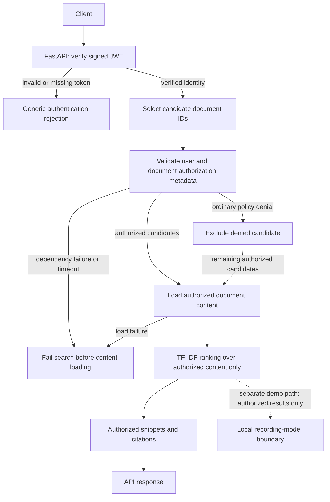

# Permission-Aware RAG Security Gateway

## Purpose

This beginner-friendly security portfolio project explores how a backend can
check document permissions before protected text is used in a retrieval-
augmented generation (RAG) workflow. It uses fictional demo data and is not a
production security gateway.

## Current status

**Current status: local security prototype.** The project includes the pure
authorization policy, authorization-first TF-IDF retrieval, authorized response
preview, a local recording-model stub, signed-token authentication in a small
FastAPI application, and best-effort in-memory audit events.
The project is not a production-ready RAG application.

Run the three-scenario local demo from the project root with:

```text
python demo.py
```

The demo uses fictional in-memory dependencies and a local recording-model
stub. Its scenarios show an authorized request reaching the stub, a denied
request that does not load protected content or invoke the stub, and a metadata
dependency failure that fails closed without invoking the stub. Output contains
only the scenario outcome and whether the stub was invoked.

## Local request flow



This diagram describes the local prototype flow, not a production deployment.
The API returns the response preview; it does not call a real LLM. The
recording-model boundary is a separate local demonstration path.

## Security design

The candidate catalog selects IDs first. Authorization metadata is validated
before protected content is loaded, and ranking uses only the content returned
for authorized candidates. Denied content must not affect relevance scores,
snippets, citations, or model input. An ordinary denial excludes its candidate;
a required metadata dependency failure stops the whole search before content
loading.

## Limitations

- Demo users, documents, metadata, and content are fictional and in memory.
- The candidate catalog is manually prepared; TF-IDF is a local baseline, not
  a production search engine.
- The model is a recording stub, not a real LLM integration.
- Audit events are best-effort and in memory, not durable or tamper-resistant.
- This is a learning prototype, not production-ready software.

Install the listed dependencies, set a local signing secret, and run the API
from the project root in PowerShell:

```powershell
python -m venv .venv
.\.venv\Scripts\Activate.ps1
python -m pip install -r requirements.txt
$env:RAG_GATEWAY_SECRET = "local-demo-secret-change-this-value-123456"
python -m uvicorn api:app --reload
```

In a second PowerShell window, log in with a fictional local account and use
the returned bearer token for a search:

```powershell
$login = Invoke-RestMethod -Method Post `
  -Uri http://127.0.0.1:8000/auth/login `
  -ContentType "application/json" `
  -Body '{"username":"engineer-demo","password":"engineering-demo-password"}'
$headers = @{ Authorization = "Bearer $($login.access_token)" }
Invoke-RestMethod -Method Post `
  -Uri http://127.0.0.1:8000/search `
  -Headers $headers `
  -ContentType "application/json" `
  -Body '{"query":"demo search"}'
```

The fictional accounts and example secret are for this local demo only; do not
reuse them or expose the app to an untrusted network.

## Optional local web interface

Install the project dependencies, including Streamlit, in the project virtual
environment. Start the API in one PowerShell terminal as shown above. In a
second terminal, activate the same environment and run:

```powershell
.\.venv\Scripts\Activate.ps1
streamlit run frontend.py
```

The interface defaults to `http://127.0.0.1:8000`. It uses the existing
`/auth/login` and `/search` API endpoints; the backend remains the only
authority for identity and document access. For the fictional engineer account,
use `engineer-demo` / `engineering-demo-password` (or the finance account,
`finance-demo` / `finance-demo-password`). The bearer token is held in the
Streamlit session and cleared on logout or when the backend URL changes.
Frontend URL validation permits only local HTTP/HTTPS hosts. This is a local
prototype, not a production deployment.

Run the test suite with:

```text
python -m unittest discover -s tests -v
```

This command is documented for running the suite; this README does not claim
that tests have passed in every environment.

### Implemented and tested in this project

- `authorization.py` defines the pure `is_authorized(user, document) -> bool`
  policy, including ordered clearance checks, public-document clearance checks,
  exact department matching for restricted documents, and no administrator
  bypass.
- `authorization_boundary.py` demonstrates a simulated identity-checking
  seam and injected metadata/content dependencies. It validates metadata before
  constructing canonical records and returns generic denial or dependency-
  failure outcomes.
- Multi-document authorization checks every candidate's metadata before
  loading any protected content. An ordinary policy denial excludes only that
  candidate (T14). A metadata lookup failure or timeout fails the whole search
  before any candidate content is loaded (T16). A content-loader failure
  returns no partial search result.
- `retrieval_boundary.py` selects candidate IDs from a small in-memory
  term-to-ID catalog without inspecting document content. It then uses the
  existing authorization boundary to validate metadata and load authorized
  content. Only those authorized documents form the TF-IDF corpus and affect
  relevance scores and result order. This is a deterministic local baseline,
  not a production search engine; the candidate catalog is manually prepared.
- `response_boundary.py` creates a local preview only from a valid, non-empty
  authorized search result. It makes snippets from at most the first 80
  characters of each non-empty text document (adding `...` when truncated)
  and uses authorized document IDs as citations. Ordinary denials exclude
  only their candidate; dependency and malformed-result failures return no
  preview content.
- `model_boundary.py` builds model input from authorized results only and uses
  a local recording-model stub. `demo.py` runs authorized, denied, and
  dependency-failure scenarios with fictional in-memory dependencies, then
  prints only generic outcomes and whether the stub was invoked.
- `api.py` provides local login and protected-search endpoints. It verifies
  signed HS256 tokens and required expiry, issuer, audience, and subject claims
  using PyJWT. User clearance, department, active status, and role come from
  fixed server-side demo records; request bodies cannot set them. Each
  authenticated search emits one structured in-memory audit event with a UTC
  timestamp, `search` action, generic outcome, and subject identifier. Events
  exclude queries, document IDs, content, snippets, credentials, tokens,
  authorization metadata, and exception details. Audit-sink failures are
  ignored so they cannot change the access decision.
- Standard-library `unittest` tests cover these policy and boundary behaviors.

“Implemented and tested” describes behavior represented by this code and its
tests. It does not establish production readiness or complete system security.

### Local demo authentication and simulated behavior

The API verifies signed tokens with PyJWT and creates `VerifiedIdentity` only
after signature and required-claim validation. Its demo accounts and all user,
document, and content records remain fictional and in memory. The separate
`demo.py` and unit-test boundaries also use injected identity fakes. The
candidate provider uses a small fixed term-to-ID catalog. Ranking is a local
TF-IDF calculation over content returned by the authorization boundary;
unauthorized content is not loaded into or included in the ranking corpus.

### Planned or not implemented

The project does not implement production identity management, production
user/document/content data adapters, a production API service, a vector
database, or an actual LLM. The local token verifier, API, and response preview
are demonstrations, not production authentication or a production
snippets/citations pipeline. The audit sink is in-memory and temporary: events
disappear when the process stops and are not tamper-proof. Production audit
logging and end-to-end safety for deployed logs, debugging output, and real
model context are also absent.

## Approved version-one authorization policy

- A request requires a valid authenticated identity; the user must exist and
  be active.
- Required identity, clearance, sensitivity, access type, and access-specific
  metadata must be present and valid. Missing, malformed, conflicting, or
  unrecognized required metadata denies access.
- User clearance must be at least document sensitivity. Public documents do
  not bypass clearance or other baseline checks.
- Department-restricted documents require an exact, case-sensitive department
  match.
- Administrator status does not bypass document-reading checks.
- Required authorization dependency failures and timeouts fail closed.
- Authorization must succeed before protected content enters results,
  snippets, citations, or model context. T14 excludes an ordinarily denied
  candidate while retaining authorized candidates. Under T16, a metadata
  dependency failure or timeout fails the entire multi-document search.

## Roadmap

1. Expand regression coverage as the local boundaries evolve.
2. Evaluate production audit storage and integrity requirements without
   recording secrets or protected content.
3. Consider an optional UI after core behavior is established.

See the [threat model](docs/threat-model.md) for the policy, current control
coverage, test plan, assumptions, and open questions.
